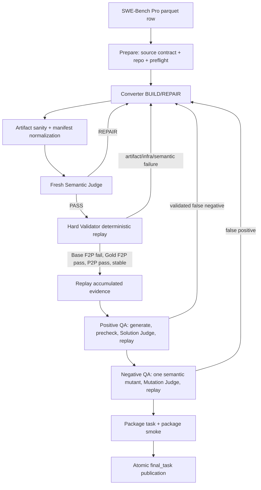

# VerifierTrans 框架总览

> 生成时间：2026-09-24 14:53:53（Asia/Shanghai）  
> 代码基线：`/lg-home/cog8/lwli6/VerifierTrans`  
> 文档目的：根据当前仓库中的实际实现，说明实验目标、端到端 pipeline、模块职责、关键数据契约和可复现入口，便于将框架介绍给不了解项目的人。

## 1. 一句话说明

VerifierTrans 把 SWE-Bench Pro 中已有的 historical F2P（fail-to-pass）测试，转换成面向公开接口和可观察行为的 functional verifier，并用确定性的 Docker 回放、语义审查、正负向候选 QA 和最终 package smoke 检查这份 verifier 是否真正可用。

框架刻意把两个问题拆开：

* Converter 决定“测什么”：理解历史测试意图，去除 private helper、内部状态和 Gold 实现细节的绑定，生成独立的功能测试及其映射证据。
* Hard Validator / execution adapter 决定“怎么运行”：冻结仓库的语言、runner、cwd、module root、selector、service、timeout、mount 和结果解析方式，执行 Base/Gold/F2P/P2P 回放。

因此，最终验收的对象不是某一个参考实现，而是一组能够识别任务行为、允许结构不同的正确实现、拒绝单点语义变异的测试契约。

## 2. 实验目的与边界

### 2.1 实验要回答的问题

实验围绕四个问题展开：

1. 历史 F2P 测试到底想验证哪个功能行为？
2. 能否把这个行为从原测试的实现绑定中抽离，落到 public API、CLI、HTTP/service、输出、持久化状态或错误语义上？
3. 转换后的 verifier 是否满足最基本的区分能力：Base 失败、Gold 通过，同时保留的 P2P 回归测试继续通过？
4. verifier 是否只接受 Gold 的写法，还是也能接受结构不同但语义正确的实现，并拒绝只违反一个已映射语义的 near-correct mutant？

### 2.2 规范来源的优先级

项目工作规范把证据分为不同角色：

* historical F2P 定义本次转换的 scope，决定哪些行为必须被映射。
* Problem Statement 定义语义边界，但不会因为描述了额外行为就自动新增没有 F2P 支持的测试要求。
* Requirements / Interface / historical tests 是 construction evidence，需要结合仓库事实解释。
* Gold patch 是 known-correct reference，可用于构造和验证，但不是唯一规范，更不能把 Gold 的私有文件结构、helper、算法或 mock 调用形状写进 verifier。

这套边界写在 [`AGENTS.md`](../../AGENTS.md)、[`docs/architecture.md`](../architecture.md) 和 [`prompts/converter.md`](../../prompts/converter.md) 中。

## 3. 端到端 pipeline

当前代码实现的主流程如下：



入口由 [`src/verifier_trans/cli.py`](../../src/verifier_trans/cli.py) 分派：普通命令进入 [`pipeline/orchestrator.py`](../../src/verifier_trans/pipeline/orchestrator.py)，`report` 进入确定性报告器，`batch` 进入批处理入口。

### 3.1 Prepare：建立不可变证据边界

命令示例：

```bash
cd /lg-home/cog8/lwli6/VerifierTrans
.venv/bin/verifier-trans prepare \
  --data /lg-home/cog8/lwli6/Data/swebench_pro/test-00000-of-00001.parquet \
  --instance-id '<INSTANCE_ID>' \
  --runs-root /lg-home/cog8/lwli6/VerifierTrans/runs \
  --materialize-repo --timeout 1800
```

Prepare 是纯确定性阶段，不调用模型，主要由 [`deterministic/preparation/prepare_instance.py`](../../src/verifier_trans/deterministic/preparation/prepare_instance.py) 完成：

* 从 parquet 唯一定位 instance，写出 `source/` 原始任务材料。
* 将问题说明和从原始 interface 中提取的公共契约放到 `source/public/`。
* 将原始 test patch、F2P/P2P seed、base state、原始测试快照放到 `source/restricted/`。
* 将 Gold patch、Requirements、原始 Interface 放到 `source/sealed/`。这是 Converter 可读的构造证据，solver/QA candidate 不可读。
* 在 Docker image 中 checkout dataset 指定的 base commit，去掉 `.git`、`node_modules` 等不需要的重量目录，并把 materialized repo 链接到 attempt 的 `prepare/repo`。
* 规范化并冻结 `restricted/resolved_test_selectors.json`。后续 Converter 不重新猜 selector；所有 replay、candidate replay、package smoke 使用同一份 resolved selector。
* 通过 [`execution/discovery.py`](../../src/verifier_trans/deterministic/execution/discovery.py) 从 `package.json`、`pyproject.toml`、`pytest.ini`、`go.mod`、`Makefile` 等仓库原生 metadata 生成 `ExecutionSpec`，并写入 `prepare/metadata.json`。

`ExecutionSpec` 是后续执行层的冻结契约，包含：`language`、`runner_family`、`package_manager`、`cwd`、`module_root`、`selector_style`、`services`、TypeScript loader、环境变量、timeout、startup timeout、kill grace 和 result parser。每个阶段结果带有 `execution_spec_hash`，避免中途重新探测导致同一 attempt 的执行语义漂移。

### 3.2 Converter：单一 BUILD/REPAIR 模式

Converter 实现位于 [`pipeline/converter.py`](../../src/verifier_trans/pipeline/converter.py)，实际 agent loop 适配位于 [`agents/miniswe_session.py`](../../src/verifier_trans/agents/miniswe_session.py)。没有独立 design agent，只有同一套 Converter 的两个工作模式：

* `BUILD`：首次生成 functional verifier。
* `REPAIR`：根据 Semantic Judge、sanity、Hard Validator、replay 或 QA 的结构化证据修复当前 verifier。

模型 session 只能把正式产物写入 `output/`（控制器侧映射为 `verifier/current`），探索写入 `scratch/`，最后必须输出 `COMPLETE_TASK_AND_SUBMIT_FINAL_OUTPUT`。控制器只提交已提交、session 隔离的 staging payload，并为每个 revision 保存不可变快照和 hash。

Converter 必须产出：

* 功能测试入口，例如 `verifier.py` 或同语言测试文件；
* 薄的 `run.sh` 兼容入口，不实现 Docker、P2P selector、service bootstrap；
* `manifest.json`，声明 `functional_artifact`、每个 executable artifact 的 `{source,target}`、描述性的 f2p/p2p command、功能 surface 及 source coverage；
* `conversion_trace.json`，每一个 canonical F2P id 一行，记录原始意图、证据、binding、observable surface、`keep/rewrite/merge/drop/spec_gap` 决策、发出的功能测试和理由；
* `instruction_scope_trace.json`，把每条 solver instruction 追溯到支持它的 F2P id；
* `coverage_matrix.md`、`conversion_log.md`、`instruction_scope.md`、`self_review.md`。

Prompt 中明确要求对 synthetic runtime、mock、fake、fixture 和 transpiler shim 做 harness coupling audit；如果结构不同的候选因为 shim 缺少标准公共属性/方法而在断言之前失败，应修复 verifier harness，而不是判候选错误。参见 [`prompts/converter.md`](../../prompts/converter.md)。

### 3.3 Artifact sanity：先检查结构，再做语义判断

[`deterministic/validation/validate_verifier.py`](../../src/verifier_trans/deterministic/validation/validate_verifier.py) 和 [`artifact_contract.py`](../../src/verifier_trans/deterministic/validation/artifact_contract.py) 负责确定性 schema gate。典型检查包括：

* `run.sh` 存在且可执行；
* `manifest.json` 可解析，`test_files` 是非空对象列表，source/target 均为仓库相对路径；
* `functional_artifact` 已声明且属于 test_files；
* manifest 中的 F2P/P2P coverage 与 Prepare 冻结的 canonical selector 一致；
* 所有 executable 文件都被声明，没有越界路径、重复 target 或未声明文件；
* artifact 内 import 和路径符合 `/app` repo、`/app/verifier` mount、`VERIFIER_REPO_ROOT` 等执行契约。

artifact 结果会被 [`add_contract`](../../src/verifier_trans/deterministic/validation/artifact_contract.py) 绑定到 `instance_id`、`verifier_revision`、`verifier_hash`、UTC 时间、status 和 failure class，防止模型输出的旧 revision 或伪造 status 覆盖控制器事实。

### 3.4 Semantic Judge：审查“测什么”

Semantic Judge 是新鲜、只读的模型审查，入口是 `orchestrator.py::run_verifier_judge`，prompt 位于 [`prompts/judges/semantic.md`](../../prompts/judges/semantic.md)。它审查：

* 每个历史 F2P 是否一一 accounting；
* 原始行为意图是否保留；
* 是否从 private helper、Gold-specific layout、mock call shape 等实现绑定迁移到 observable surface；
* `instruction_scope.md` 是否只包含 F2P 支持的语义和必要公共契约；
* P2P 是否与 converted F2P 分离；
* synthetic harness 是否覆盖结构不同实现可能使用的标准公共路径。

Semantic Judge 的 PASS 只代表语义审查通过，不能替代后续真实回放。

### 3.5 Hard Validator：Base/Gold + F2P/P2P + stability

硬门由 [`deterministic/replay/verifier.py`](../../src/verifier_trans/deterministic/replay/verifier.py) 执行。每一轮至少运行四个组合：

| 状态 | converted F2P | retained P2P |
|---|---:|---:|
| Base checkout | 必须失败 | 必须通过 |
| Gold patch checkout | 必须通过 | 必须通过 |

控制器默认重复回放两次（`configs/experiment.yaml` 的 `replay_repeats: 2`），八个布尔结果签名完全一致才算 stable。接受条件在代码的 `accepted()` 中明确写成：

```text
Base F2P runnable && Base F2P passed == false
Gold F2P runnable && Gold F2P passed == true
Base P2P runnable && Base P2P passed == true
Gold P2P runnable && Gold P2P passed == true
&& stable
```

Docker command、mount、cwd、service、语言 runner、timeout 和 marker parser 均由 execution adapter 提供；模型生成的 verifier 不负责这些基础设施。

### 3.6 Execution adapter：跨语言统一执行契约

核心接口在 [`deterministic/execution/base.py`](../../src/verifier_trans/deterministic/execution/base.py)，当前适配器包括：

* Python：[`execution/python.py`](../../src/verifier_trans/deterministic/execution/python.py)，功能 artifact 用 `python3`，P2P 使用 framework-owned `p2p_runner.py`。
* Node/TypeScript：[`execution/node.py`](../../src/verifier_trans/deterministic/execution/node.py)，支持 Mocha/Jest/Vitest/ospec；Mocha 根据冻结 metadata 选择 TypeScript loader，Jest/Vitest 走仓库自身配置。
* Go：[`execution/go.py`](../../src/verifier_trans/deterministic/execution/go.py)，功能 artifact 用 `go test`，P2P 使用 `go_p2p_runner.py`。

execution adapter 还统一：

* `standard_role_mounts()`：verifier、sealed、restricted selectors、logs 的 canonical mount；
* `contract_environment_args()`：把冻结环境变量渲染为 Docker `-e`；
* service lifecycle：例如只有 image 同时提供 `redis-server`/`redis-cli` 时才做有界 Redis bootstrap；
* marker-v1 结果解析与 infrastructure failure 分类。

未知 runner 或必要 metadata 缺失时，框架明确返回 unsupported/infrastructure，不通过一个薄的猜测入口掩盖问题。

### 3.7 QA：正确性、实现多样性和拒绝能力

QA 代码在 [`pipeline/qa.py`](../../src/verifier_trans/pipeline/qa.py) 和 orchestrator 的候选流程中。

#### Positive QA

Positive generator 生成一个结构不同的候选实现，候选先经过确定性 precheck：

```text
retained P2P runnable + PASS
current converted F2P runnable
结构上不是 exact Gold reproduction
没有 infrastructure failure
```

这里 current F2P 可以“可运行但失败”，因为这正是发现 verifier false negative 所需的证据。随后 Solution Judge 判断候选是否真的是语义正确的 alternative implementation；Judge 判 `VALID` 后，框架重新 replay current F2P、P2P 和 historical F2P：

* `current F2P PASS + P2P PASS`：接受为 positive evidence；
* Judge 认为正确，但 current F2P 是 runnable semantic failure：标记 `VERIFIER_FALSE_NEGATIVE`，回到 Converter REPAIR；
* historical F2P 只保留为 audit evidence，不作为 Positive validity gate；
* Docker、toolchain、mount、timeout 等失败归为 infrastructure，不触发语义修复。

当前 Positive evidence contract 为 v5，旧 contract 的 payload 会保留审计，但不能静默计入新的目标。

#### Negative QA

Negative mutator 从已接受的 positive parent 出发，只违反一个已映射的 F2P 语义。Mutation Judge 必须给出 `RELEVANT_NON_EQUIVALENT`，并且：

```text
P2P PASS + current F2P FAIL + no infrastructure failure
```

才算一个合格 mutant。若 mutant 仍通过 current F2P，则是 verifier false positive，回到 REPAIR；若执行环境失败，只记录 infrastructure。

默认配置要求至少 1 个 valid positive 和 2 个 eligible mutants，且分别受 `max_positive_attempts`、`max_mutation_attempts` 限制。

### 3.8 Package、smoke 和 final_task

通过全部 gate 后，控制器调用 [`deterministic/packaging/package_task.py`](../../src/verifier_trans/deterministic/packaging/package_task.py)：

* 从 verifier manifest 读取功能 artifact，生成 repository patch；
* 使用 Prepare 生成的 `restricted/p2p_assets.json` 和 [`packaging/test_patch.py`](../../src/verifier_trans/deterministic/packaging/test_patch.py) 保留 P2P 所需测试、shared setup/fixture，并排除 F2P-only test；
* 生成 DeepSWE 兼容的 `task.toml`、`instruction.md`、`environment/Dockerfile`、`tests/{test.sh,grader.py,config.json,test.patch}`、`solution/solution.patch`；
* package 中的 F2P/P2P command 继续来自同一份冻结 ExecutionSpec，不重新猜 runner。

随后 [`package_smoke.py`](../../src/verifier_trans/deterministic/packaging/package_smoke.py) 在 clean Base checkout 中应用 package wiring、converted verifier 和 Gold solution patch，执行最终 `tests/test.sh`。只有 smoke PASS，才由 [`pipeline/artifacts.py::publish_final_task`](../../src/verifier_trans/pipeline/artifacts.py) 通过临时目录 rename 原子发布 `runs/<instance>/final_task/`。

最终 task 的 reward grader 只运行 converted F2P + retained P2P；historical F2P 不进入最终 reward。Gold patch 作为 held-out `solution.patch` 保存用于离线检查。

## 4. Runs 与审计产物布局

新的 instance-centric 布局由 [`paths.py`](../../src/verifier_trans/paths.py) 管理：

```text
runs/<instance_id>/
├── source/                         immutable 输入边界
│   ├── dataset_row.json
│   ├── metadata.json
│   ├── source_manifest.json
│   ├── public/{problem_statement.md,interface_contract.md,repo}
│   ├── restricted/{original_test.patch,test_seeds.json,
│   │               resolved_test_selectors.json,p2p_assets.json,original_tests/}
│   ├── sealed/{gold.patch,requirements.md,interface.md}
│   └── reference/deepswe_verifier_taxonomy.md
├── intermediate/
│   ├── latest_attempt.json
│   └── attempts/attempt_NNN/
│       ├── prepare/{repo,logs,metadata.json,source_preflight.json,environment_preflight.json}
│       ├── converter/{current,revisions,staging,trajectories,live}
│       ├── validation/{sanity,semantic,hard_replay,evidence_replay}
│       ├── qa/{positive,negative,candidates,evidence.json}
│       ├── packaging/{candidate_task,logs,package_report.json,smoke_report.json}
│       └── control/{state.json,events.jsonl,final.json,report.json}
├── final_task/                     通过 smoke 后原子发布
└── review/{progress.md,progress.json,report.md,metrics.json}
```

`.compat/` 是兼容旧接口的相对 symlink 视图，例如 `.compat/verifier -> converter/current`、`.compat/run/check.json -> validation/hard_replay/latest_check.json`。它不复制 artifact，也不进入 final_task。

状态与证据分工如下：

* `control/state.json`：快速状态视图；
* `control/events.jsonl`：追加式事实流，记录每个 stage、revision、retry 和 failure domain；
* `control/final.json`：最终 gate 结果；
* `qa/evidence.json`：positive/mutant 累积证据；
* `review/report.md`、`review/metrics.json`：由 [`deterministic/reporting/report.py`](../../src/verifier_trans/deterministic/reporting/report.py) 基于已有 artifact 确定性生成，包含 F2P mapping 数量、阶段耗时、model usage、gate 结果和 QA 摘要。

## 5. 失败分类与修复路由

框架不会看到任意失败就修改 verifier。控制器和 artifact contract 使用以下 failure class：

| failure class | 典型原因 | 路由 |
|---|---|---|
| `ARTIFACT_SCHEMA` | manifest、path、声明文件、self-review、coverage 不符合契约 | Converter REPAIR |
| `INFRASTRUCTURE` | Docker、mount、cwd、service、toolchain、selector、timeout、marker | 有界 retry 或人工检查，不改语义 |
| `VERIFIER_SEMANTIC` | overreach、false negative、false positive、错误 observable surface | Converter REPAIR |
| `QA_DEFECT` | candidate/mutant contract 或 QA 证据不成立 | 重新生成或回到对应 QA |
| `PACKAGE` | patch accounting、package wiring、smoke 失败 | package 修复/人工检查 |

`orchestrator.py` 通过 revision loop 实现证据驱动修复：每次修复都带上 core gate、semantic 或 QA 的结构化 failure packet；修复后重新走 sanity → Semantic Judge → Hard Validator → replay → QA，不允许后面的 PASS 跳过前面的 gate。旧 evidence 只有在 revision、verifier hash、execution contract 都匹配时才可复用。

## 6. 常用操作入口

开始一轮转换：

```bash
.venv/bin/verifier-trans run \
  --instance-id '<INSTANCE_ID>' \
  --runs-root /lg-home/cog8/lwli6/VerifierTrans/runs \
  --env-file /lg-home/cog8/lwli6/VerifierTrans/.env \
  --config /lg-home/cog8/lwli6/VerifierTrans/configs/experiment.yaml \
  --allow-external-model-data
```

恢复最新 attempt：

```bash
.venv/bin/verifier-trans resume \
  --instance-id '<INSTANCE_ID>' \
  --runs-root /lg-home/cog8/lwli6/VerifierTrans/runs \
  --env-file /lg-home/cog8/lwli6/VerifierTrans/.env \
  --config /lg-home/cog8/lwli6/VerifierTrans/configs/experiment.yaml \
  --allow-external-model-data
```

只重建审计报告：

```bash
.venv/bin/verifier-trans report \
  --instance-id '<INSTANCE_ID>' \
  --runs-root /lg-home/cog8/lwli6/VerifierTrans/runs
```

批处理入口 [`batch.py`](../../src/verifier_trans/batch.py) 对已 Prepare 的多个 attempt 使用有界并发，并把结果写到 `runs/batch_summary.json`。

`--allow-external-model-data` 是显式授权开关：因为 Converter、QA generator 和 Judge 会把任务仓库及测试上下文发送到配置的模型服务，没有该开关，controller 会拒绝启动 model-backed conversion。

## 7. 关键配置与可调整旋钮

[`configs/experiment.yaml`](../../configs/experiment.yaml) 当前定义了：

* model backend、request timeout、Converter/Judge token budget；
* Converter、repair、solver、mutation 的工具步数上限；
* `max_verifier_revisions: 3`；
* verifier、QA、package smoke timeout；
* `replay_repeats: 2`、`infra_retry_limit: 1`；
* positive/mutant 目标和尝试上限。

这些值是预算和可靠性旋钮，不替代验收契约。比如 `converter_step_cap` 只限制一次 agent session 的工具步数，是否成功仍由显式 submit、artifact sanity、Semantic Judge、Hard Validator 和 QA 决定。

模型角色 prompt 位于：

* [`prompts/converter.md`](../../prompts/converter.md)：F2P 转换、artifact contract、harness audit；
* [`prompts/qa/positive_generator.md`](../../prompts/qa/positive_generator.md)：生成结构不同的正确候选；
* [`prompts/qa/negative_generator.md`](../../prompts/qa/negative_generator.md)：生成单一语义变异；
* [`prompts/judges/semantic.md`](../../prompts/judges/semantic.md)：verifier 语义审查；
* [`prompts/judges/positive.md`](../../prompts/judges/positive.md)、[`negative.md`](../../prompts/judges/negative.md)：候选语义判定。

## 8. 一个最小的结果判读方法

拿到一次 run 后，建议按以下顺序阅读，而不是只看最终 return code：

1. `prepare/source_preflight.json` 和 `prepare/environment_preflight.json`：确认 source/base checkout、runner、依赖和 selector 先验成立。
2. `converter/current/conversion_trace.json`、`manifest.json`、`instruction_scope.md`：确认每条 F2P 是否被映射，测试范围是否过宽。
3. `validation/sanity/` 和 `validation/semantic/`：区分 artifact/schema 问题与语义判断问题。
4. `validation/hard_replay/`：核对 Base/Gold F2P、Base/Gold P2P、stable 和 `execution_spec_hash`。
5. `qa/evidence.json`：看 Positive 是否经过 Judge 后仍能通过 current F2P/P2P，Negative 是否真的是单一相关变异并被拒绝。
6. `packaging/package_report.json`、`smoke_report.json` 和 `final_task/provenance.json`：确认最终发布物和中间 revision 的对应关系。

报告可用 `verifier-trans report` 无模型重建；事件流、日志、trajectory 和 revision snapshot 共同构成可审计链路。

## 9. 当前验证边界与已知限制

仓库当前已经实现 Python、Node/TypeScript、Go 的 ExecutionSpec 和对应 adapter，也实现了 instance-centric runs、revision-bound evidence、分层 QA、package smoke 和原子发布。但“代码路径存在”不等于所有生态都已经完成 fresh Docker E2E cross-validation。

README 和 [`docs/architecture.md`](../architecture.md) 明确记录：四条 fresh Python/JavaScript/TypeScript/Go Docker cross-validation 仍是需要继续完成的验证工作。最近的 Tutanota DOM/runtime-shim 审计还发现 synthetic DOM 缺少标准 `querySelector/querySelectorAll`，以及固定 TypeScript runtime shim 可能形成公共契约耦合；该类问题应归为 `VERIFIER_SEMANTIC`，交给 Converter REPAIR，而不是误判为 candidate 错误。相关过程记录见 [`process/20260923T065319Z_framework_dom_query_and_runtime_shim.md`](../../process/20260923T065319Z_framework_dom_query_and_runtime_shim.md)。

因此，对外介绍框架时可以说：当前实现已经把“转换、确定性回放、QA、打包、审计”串成一条可复现 pipeline；不应把尚未完成的跨生态 fresh Docker 验证描述成已经获得全面支持。

## 10. 代码导航表

| 关注点 | 主要文件 |
|---|---|
| CLI / run / resume / report | [`src/verifier_trans/cli.py`](../../src/verifier_trans/cli.py)、[`pipeline/orchestrator.py`](../../src/verifier_trans/pipeline/orchestrator.py) |
| runs 布局、attempt、兼容 symlink | [`src/verifier_trans/paths.py`](../../src/verifier_trans/paths.py) |
| Prepare、source boundary、selector 冻结 | [`deterministic/preparation/prepare_instance.py`](../../src/verifier_trans/deterministic/preparation/prepare_instance.py)、[`preparation/common.py`](../../src/verifier_trans/deterministic/preparation/common.py) |
| ExecutionSpec discovery | [`deterministic/execution/discovery.py`](../../src/verifier_trans/deterministic/execution/discovery.py) |
| Python / Node / Go adapter | [`deterministic/execution/python.py`](../../src/verifier_trans/deterministic/execution/python.py)、[`node.py`](../../src/verifier_trans/deterministic/execution/node.py)、[`go.py`](../../src/verifier_trans/deterministic/execution/go.py) |
| 统一 execution plan、mount、环境 | [`deterministic/execution/base.py`](../../src/verifier_trans/deterministic/execution/base.py) |
| Base/Gold/P2P/F2P replay | [`deterministic/replay/verifier.py`](../../src/verifier_trans/deterministic/replay/verifier.py) |
| Positive / mutant candidate replay | [`deterministic/replay/candidate.py`](../../src/verifier_trans/deterministic/replay/candidate.py) |
| QA contract | [`pipeline/qa.py`](../../src/verifier_trans/pipeline/qa.py) |
| Artifact/schema contract | [`deterministic/validation/validate_verifier.py`](../../src/verifier_trans/deterministic/validation/validate_verifier.py)、[`artifact_contract.py`](../../src/verifier_trans/deterministic/validation/artifact_contract.py) |
| Package 与 P2P patch accounting | [`deterministic/packaging/package_task.py`](../../src/verifier_trans/deterministic/packaging/package_task.py)、[`test_patch.py`](../../src/verifier_trans/deterministic/packaging/test_patch.py) |
| Smoke / final publication | [`deterministic/packaging/package_smoke.py`](../../src/verifier_trans/deterministic/packaging/package_smoke.py)、[`pipeline/artifacts.py`](../../src/verifier_trans/pipeline/artifacts.py) |
| 报告、metrics、progress | [`deterministic/reporting/report.py`](../../src/verifier_trans/deterministic/reporting/report.py) |
| Converter session / model tool loop | [`agents/miniswe_session.py`](../../src/verifier_trans/agents/miniswe_session.py)、[`agents/workspace_tools.py`](../../src/verifier_trans/agents/workspace_tools.py) |
| 设计约束与角色 prompt | [`AGENTS.md`](../../AGENTS.md)、[`prompts/converter.md`](../../prompts/converter.md)、[`prompts/judges/`](../../prompts/judges/) |

## 11. 对外转述版

可以把 VerifierTrans 概括为：

> 它读取一条 SWE-Bench Pro 任务，把原始 F2P 测试的行为意图转换成独立的功能 verifier；Prepare 阶段冻结数据、仓库和执行契约，Converter 生成并记录每条 F2P 的 observable mapping，Semantic Judge 审查语义，Hard Validator 在 Base/Gold 和 P2P 上做确定性回放，Positive/Negative QA 检查实现多样性与拒绝能力，最后通过 package smoke 原子发布一个可复现的 DeepSWE task。所有阶段都输出带 revision、hash、时间戳和 failure class 的结构化证据，因此失败可以区分为 artifact、基础设施、语义、QA 或 packaging 问题，并沿对应路径修复。

